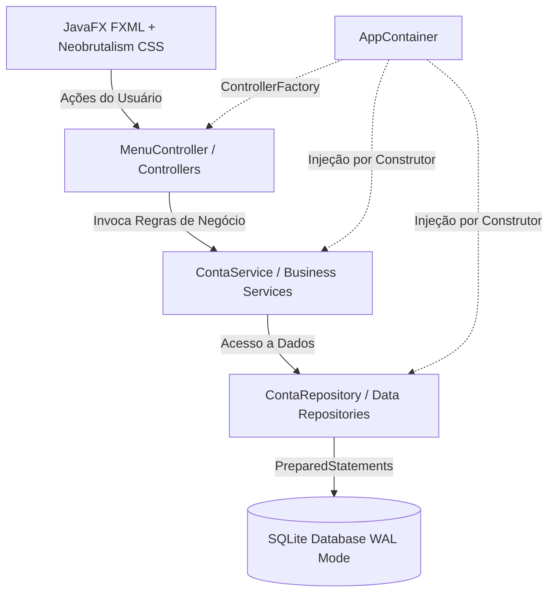

# FinDesk FX — Core Financeiro Desktop Offline

> **Motor financeiro desktop de alta performance, 100% offline e resiliente a quedas de energia.**  
> Desenvolvido em **Java 21 LTS**, **JavaFX** com estética **Neobrutalista** e banco de dados **SQLite WAL**.

---

## 🎯 Sobre o Projeto & Visão de Arquitetura

O **FinDesk FX** foi concebido como um **núcleo financeiro desktop reutilizável (white-label)** para micro e pequenas empresas que necessitam de controle rigoroso de fluxo de caixa sem depender de internet, servidores complexos ou custos recorrentes de nuvem.

O projeto foi pilotado e validado em ambiente real de alta rotatividade operacional (*Chaveiro Universal*), substituindo controles legados em planilhas por uma arquitetura transacional robusta, blindada contra erros humanos e falhas elétricas.

---

## 🚀 Principais Diferenciais e Inovações Técnicas

### 1. 🛡️ Persistência SQLite com Crash-Resilience (Modo WAL)
* **Write-Ahead Logging (WAL):** Configurado com `PRAGMA journal_mode = WAL` e `PRAGMA synchronous = NORMAL`, garantindo que leituras e escritas não se bloqueiem mutuamente e evitando corrupção de dados em caso de queda súbita de energia.
* **Integridade Referencial Estrita:** Chaves estrangeiras ativadas nativamente (`PRAGMA foreign_keys = ON`).
* **Blindagem contra SQL Injection:** 100% das operações de banco utilizam `PreparedStatement` parametrizados.
* **Auditoria Transacional ACID:** Cada baixa ou alteração de título é gravada atomicamente na mesma transação da tabela de auditoria (`auditoria_operacoes`).

### 2. ⚡ Pure Dependency Injection (Manual DI / Sem Bloatware)
* **Zero Overhead de Framework:** Ao invés de carregar um Spring Boot pesado (que adicionaria centenas de megabytes e segundos preciosos de inicialização a um aplicativo desktop), o projeto utiliza **Pure DI** via [AppContainer.java](file:///c:/contas_pagar_chaveiro_universal/src/main/java/com/chaveiro/AppContainer.java).
* **Controlador Injetável via Fábrica:** O [FXMLLoader](file:///c:/contas_pagar_chaveiro_universal/src/main/java/com/chaveiro/App.java) utiliza um `ControllerFactory` customizado, garantindo injeção de dependências limpa por construtor em todos os Controllers.
* **Testabilidade Total:** Repositórios e Serviços podem ser mockados ou instanciados diretamente em testes sem necessidade de inicializar contextos pesados.

### 3. ☕ Java 21 LTS Moderno & Pragmatismo
* **Java Records Imutáveis:** Uso extensivo de `record` para todos os modelos de domínio (ex: `Conta`, `Pagamento`, `Banco`, `Empresa`, `NotaFiscal`), eliminando boilerplate e garantindo imutabilidade de estado.
* **Pattern Matching & Switch Expressions:** Código conciso, expressivo e estaticamente seguro para regras de negócio e transições de status (`StatusConta`, `FormaPagamento`).
* **Resource Management:** Gerenciamento rigoroso de conexões e recursos via `try-with-resources`.

### 4. 🎨 Design System Neobrutalista no JavaFX
* **UI de Alto Contraste:** Estética Neobrutalista inspirada em protótipos modernos do *Stitch with Google* (bordas sólidas pretas de 3px a 4px, sombras duras `4px 4px 0px #000`, paleta vibrante de alta visibilidade: Amarelo `#FFE600`, Azul `#2563EB`, Roxo `#9333EA`, Verde `#10B981`).
* **Ergonomia para Usuários Leigos:** Botões gigantes, tipografia clara (*Space Grotesk* / *Inter*), navegação autoexplicativa e fluxos em etapas sem poluição visual.
* **CSS Nativo Modular:** Estilos desacoplados em folha de estilos dedicada (`neobrutalism.css`) sem poluir a lógica dos Controllers.

### 5. 🧵 Interface Responsiva & Thread-Safety
* **Zero Travamento de UI:** Operações pesadas e I/O de disco/banco são orquestradas assincronamente através de `javafx.concurrent.Task` e sincronizadas na Thread de Aplicação via `Platform.runLater`.

### 6. 🧪 TDD com JUnit 5 & AssertJ
* Cobertura de regras críticas financeiras (cálculo de atrasos, juros, multas, regras de recorrência e liquidação) utilizando **Given-When-Then** e asserções fluentes com AssertJ.

---

## 🏛️ Arquitetura do Sistema



---

## 📂 Estrutura do Repositório

```text
├── src
│   ├── main
│   │   ├── java/com/chaveiro
│   │   │   ├── controller       # Controladores finos de UI (JavaFX)
│   │   │   ├── database         # ConnectionFactory, SQLite WAL & Migrações
│   │   │   ├── model            # Records imutáveis de domínio (Java 21)
│   │   │   ├── repository       # Acesso a dados com PreparedStatements e transações ACID
│   │   │   ├── service          # Regras de negócio, cálculos financeiros e auditoria
│   │   │   ├── App.java         # Ponto de entrada JavaFX
│   │   │   └── AppContainer.java# Injetor de dependências puro (Pure DI)
│   │   └── resources
│   │       ├── styles           # Neobrutalism CSS nativo JavaFX
│   │       └── view             # FXMLs de telas e componentes
│   └── test
│       └── java/com/chaveiro    # Testes unitários com JUnit 5 e AssertJ
├── pom.xml                      # Gerenciador de dependências Maven
└── LICENSE.md                   # Termos de uso e propriedade intelectual
```

---

## 🛠️ Tecnologias Utilizadas

| Tecnologia | Versão / Finalidade |
| :--- | :--- |
| **Java** | 21 LTS (Records, Pattern Matching, Clean Core) |
| **JavaFX** | 21.0.2 (Controls & FXML) |
| **SQLite JDBC** | 3.45.2.0 (Persistência local ACID em arquivo único) |
| **JUnit 5** | 5.10.2 (Testes de unidade estruturados) |
| **AssertJ** | 3.25.3 (Asserções fluentes e expressivas) |
| **Maven** | Gerenciamento de ciclo de vida e compilação |

---

## 💻 Como Executar

### Pré-requisitos
* **JDK 21** instalado e configurado no PATH (`JAVA_HOME`).
* **Maven 3.9+** instalado.

### Executar a Aplicação
```bash
# Rodar via plugin oficial do JavaFX
mvn javafx:run
```

### Executar a Suíte de Testes
```bash
# Rodar testes automatizados
mvn test
```

---

## 🔒 Licença & Propriedade Intelectual

Este projeto está registrado sob **Licença Proprietária / Source-Available**.  
Consulte o arquivo [LICENSE.md](file:///c:/contas_pagar_chaveiro_universal/LICENSE.md) para detalhes.

O código está público no GitHub para fins exclusivos de **auditoria técnica, avaliação em processos seletivos e demonstração de portfólio**. É estritamente proibida a cópia, redistribuição ou exploração comercial deste software sem autorização prévia por escrito.
