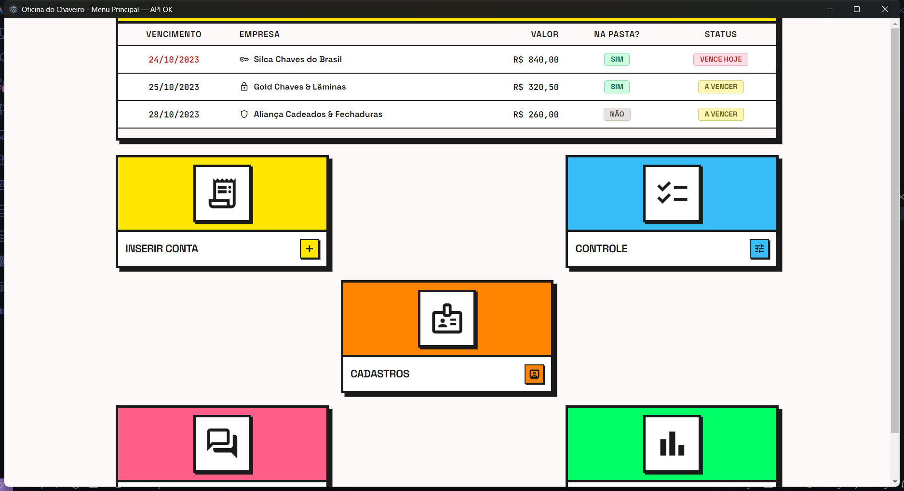

# FinDesk — Sistema de Contas a Pagar (Chaveiro Universal)

Aplicativo desktop offline para gestão de contas a pagar de pequenos negócios: cadastro de contas, controle de vencimentos, baixas de pagamento, contas recorrentes, cadastros, quadro de avisos e indicadores. Desenvolvido para operar **100% sem internet**, com interface fiel a um design aprovado no Google Stitch e backend em Java com regras de negócio isoladas da interface.

> **Status:** Fase 1 concluída (interface + comunicação local). Funcionalidades financeiras ainda não estão conectadas a banco de dados — os dados exibidos são **simulados**. Detalhes na seção [Status do desenvolvimento](#status-do-desenvolvimento).

---

## Sumário

- [Objetivo](#objetivo)
- [Tecnologias](#tecnologias)
- [Arquitetura](#arquitetura)
- [API REST local](#api-rest-local)
- [Funcionalidades da Fase 1](#funcionalidades-da-fase-1)
- [Próximas fases](#próximas-fases)
- [Estrutura do projeto](#estrutura-do-projeto)
- [Requisitos e execução local](#requisitos-e-execução-local)
- [Segurança e funcionamento offline](#segurança-e-funcionamento-offline)
- [Interface](#interface)
- [Status do desenvolvimento](#status-do-desenvolvimento)
- [Licença](#licença)

---

## Objetivo

Substituir o controle de contas a pagar em planilha Excel/VBA por um aplicativo desktop robusto, com:

- interface autoexplicativa para usuários leigos (botões grandes, alto contraste);
- regras financeiras centralizadas no backend, testadas e auditáveis;
- integridade de dados (transações, auditoria, prevenção de duplicidade);
- operação sem internet e sem servidores externos;
- caminho de evolução para uma versão web no futuro, sem reescrever o backend.

## Tecnologias

| Camada | Tecnologia |
|---|---|
| Desktop | Electron 33 |
| Frontend | HTML5, CSS3 e **TypeScript puro** (sem React/Angular/Vue) |
| Estilos | CSS estático gerado com Tailwind CSS (build local, sem CDN) |
| Compilação TS | esbuild + `tsc` (typecheck em modo estrito) |
| Backend | Java 21 + Spring Boot 3.3 |
| Comunicação | API REST local (JSON) sobre HTTP em `127.0.0.1` |
| Banco de dados | SQLite (previsto para a Fase 2) |
| Build Java | Maven |
| Testes | JUnit 5 + Spring MockMvc |

## Arquitetura

```text
┌──────────────────────────────┐
│  Electron (janela desktop)   │
│  ├── frontend/ (HTML+CSS+TS) │  interface: Menu Principal do Stitch
│  └── processo principal      │  inicia/encerra o backend, porta + token
└──────────────┬───────────────┘
               │ HTTP127.0.0.1 + header X-FinDesk-Token
┌──────────────▼───────────────┐
│  Spring Boot (backend Java)  │  regras de negócio e API REST
│  controllers → services      │  independente do Electron
│  → repositories → SQLite     │  (camada de dados na Fase 2)
└──────────────────────────────┘
```

Decisões principais:

- **Separação real entre UI e regra de negócio:** o frontend consome a API e não contém lógica financeira; o backend não conhece o Electron — requisito para a futura versão web.
- **Processo único:** o Electron escolhe uma porta livre, gera um token por execução, aguarda o backend responder e o encerra junto com a janela (sem processos órfãos; instância única garantida).
- **Backend legado:** o núcleo financeiro Java anterior (models, repositórios, serviço, DDL SQLite) está preservado no histórico Git e será reaproveitado na Fase 2.

## API REST local

| Método | Endpoint | Descrição | Status |
|---|---|---|---|
| GET | `/api/status` | Saúde da API | Implementado |
| GET | `/api/contas` | Lista de contas | Implementado com **dados simulados** |

- Endereço fixo `127.0.0.1` (não exposto na rede local); porta dinâmica por execução.
- Autenticação: header `X-FinDesk-Token` com valor aleatório gerado a cada inicialização — sem token, a resposta é `401`.
- CORS restrito às origens da aplicação local.
- Erros padronizados em JSON, sem vazamento de detalhes internos.

## Funcionalidades da Fase 1

- Janela desktop própria (Electron) abrindo com dois cliques via comando de desenvolvimento.
- **Menu Principal recuperado do Google Stitch** (HTML original), executado offline.
- Comunicação real frontend TypeScript ↔ backend Java via API REST autenticada.
- Os 5 botões do menu respondem (comportamento provisório) e atalhos F1–F4 funcionam.
- Encerramento limpo: fechar a janela encerra o backend (verificado sem processos residuais).
- Proteção contra múltiplas instâncias.
- CSP (Content-Security-Policy) ativa na página, sem avisos de segurança do Electron.
- Compilação com verificação de tipos estrita (`tsc --noEmit`) e build reproduzível.

## Próximas fases

| Fase | Escopo |
|---|---|
| 2 | SQLite (WAL, integridade referencial), `BigDecimal` para valores, cadastros (contas, empresas, pagadores, bancos), backup/restauração |
| 3 | Fluxo financeiro: pendentes, pagas, baixa com transação atômica e auditoria, vencimentos, contas recorrentes (regras do VBA original) |
| 4 | Mensagens/avisos, filtros, gráficos e relatórios |
| 5 | Testes completos, logs com rotação, empacotamento Windows (Electron Forge + JRE via `jpackage`), instalação e atualização |

Nenhuma dessas fases está concluída nesta versão.

## Estrutura do projeto

```text
sistema_contas_a_pagar_desktop_offline/
├── backend/                  # Spring Boot (Java 21) — API REST
│   ├── pom.xml
│   └── src/ (main + test)
├── desktop/                  # processo Electron (main.js, preload.js)
├── frontend/
│   ├── html/menu.html        # HTML original do Stitch (adaptado ao offline)
│   ├── css/                  # fonts.css + fontes do build Tailwind
│   ├── ts/                   # TypeScript puro (api.ts, main.ts)
│   ├── assets/fonts/         # fontes WOFF2 locais (offline)
│   └── dist/                 # artefatos gerados (não versionados)
├── docs/                     # imagens da documentação
├── telas_referencia/         # 28 PNGs de referência do design Stitch
├── package.json              # scripts e dependências de desenvolvimento
├── tailwind.config.js        # configuração extraída do design
├── tsconfig.json             # TypeScript estrito
├── .env.example              # modelo de configuração (sem segredos)
├── src/, pom.xml             # legado JavaFX (preservado; ver branch main)
├── BRIEFING_PROJETO.md       # briefing original do projeto
└── LICENSE.md
```

## Requisitos e execução local

**Pré-requisitos (máquina de desenvolvimento):**

- Windows 10/11 (plataforma testada)
- JDK 21
- Maven 3.9+
- Node.js 20+ e npm
- Git

**Execução:**

```bash
git clone https://github.com/FelipeSilveiraP/sistema_contas_a_pagar_desktop_offline.git
cd sistema_contas_a_pagar_desktop_offline

npm install                      # dependências de frontend/desktop
mvn -f backend/pom.xml package   # compila o backend (gera o .jar)
npm run dev                      # build do frontend + abre a janela
```

**Testes e verificações:**

```bash
mvn -f backend/pom.xml test   # testes do backend (JUnit 5)
npm run typecheck             # verificação de tipos do TypeScript
npm run build                 # gera CSS estático e bundle JS
```

Todos os comandos acima foram executados e verificados nesta fase.

## Segurança e funcionamento offline

- **Offline total da interface:** fontes WOFF2 e CSS do Tailwind são gerados/servidos localmente — nenhuma chamada de rede externa em execução (CDN do Tailwind e Google Fonts removidos).
- **API local isolada:** servidor vinculado a `127.0.0.1`; não responde na rede local ou internet.
- **Token por execução:** valor aleatório a cada inicialização, exposto ao renderer via `contextBridge` (sem `nodeIntegration`); não é gravado em logs.
- **CSP ativa** na página e permissões padrão do Electron endurecidas (`contextIsolation`).
- **Repositório sem credenciais:** arquivos de ambiente (`.env`), planilhas financeiras, bancos SQLite, logs e scripts de integração local são ignorados pelo `.gitignore`; `.env.example` contém apenas nomes de variáveis fictícias.
- **Próximos passos de segurança (Fase 2+):** transações ACID no SQLite, auditoria de operações financeiras, backup automático com teste de restauração.

## Interface

Menu Principal recuperado do Google Stitch e executado no Electron durante a Fase 1.
Os dados exibidos (empresas, valores, datas) são **mockups do design original** — não há dados reais da empresa nesta tela.



## Status do desenvolvimento

| Marco | Situação |
|---|---|
| Fase 0 — Auditoria e planejamento | Concluída |
| Fase 1 — Interface + API local | **Concluída** (branch `develop`) |
| Fase 2 — Banco de dados e cadastros | Não iniciada |
| Fase 3 — Fluxo financeiro completo | Não iniciada |
| Fase 4 — Mensagens, filtros, gráficos | Não iniciada |
| Fase 5 — Testes finais e instalador Windows | Não iniciada |

Limitações desta versão:

- dados de contas **simulados** (sem persistência);
- nenhum módulo financeiro está em produção;
- o instalador definitivo ainda não foi gerado;
- validação de layout pendente na resolução real do monitor da empresa.

## Licença

Licença proprietária / source-available — Copyright (c) 2026 Felipe / Contas a Pagar Core. Todos os direitos reservados.

O código-fonte é público exclusivamente para auditoria técnica, avaliação em processos seletivos e estudo. É vedada a exploração comercial. Consulte [LICENSE.md](LICENSE.md) para os termos completos.
